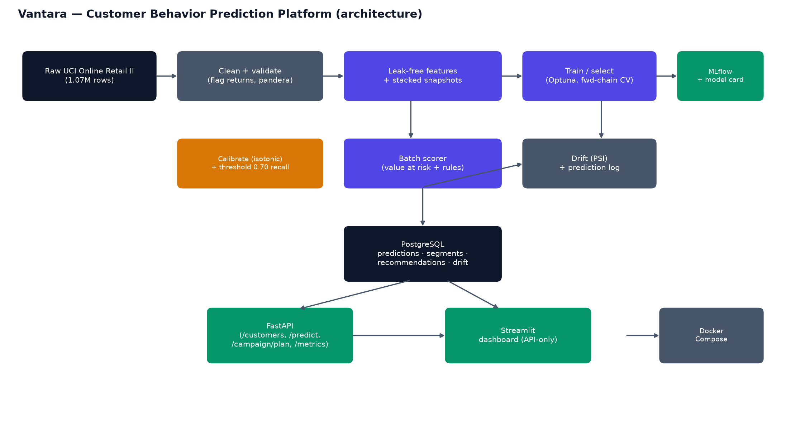

# Vantara Retail Solutions — Customer Behavior Prediction Platform

[](https://github.com/Naman6019/vantara-retention-ml/actions)
[](https://www.python.org/)
[](https://fastapi.tiangolo.com/)
[](https://streamlit.io/)
[](https://creativecommons.org/licenses/by/4.0/)

An end-to-end ML platform for omnichannel retail customer analytics: **calibrated
churn risk**, **90-day customer value**, **value-at-risk retention prioritisation**,
**probabilistic CLV (BG/NBD + Gamma-Gamma)**, **budget-constrained campaign planning**,
**personalised product recommendations**, segmentation, and explainable AI (SHAP **and** LIME) — served through a FastAPI
service and an API-only Streamlit dashboard, with PostgreSQL persistence and drift
monitoring.

> Evaluation is **out-of-time** (stacked monthly snapshots, the test cutoff scored
> once). Numbers are lower than a random split would show, and the report explains why.

---

> **About this project.** Built during an AI internship at Internmo from a client-style brief.
> Vantara Retail Solutions is a fictional client in that brief, and the brief itself isn't
> included here. The data is the public UCI Online Retail II dataset.

---

## Results at a glance (out-of-time)

| Task | Metric | Value |
|---|---|---|
| Churn (calibrated) | Test ROC-AUC / recall @ threshold 0.671 | **0.756 / 71.3%** |
| 90-day value | Validation MAE / top-decile value capture | **£284 / 63.9%** |
| Probabilistic CLV | BG/NBD + Gamma-Gamma MAE / capture (validation) | £525 / 40.3% |
| Product recommendations | Test customers buying ≥ 1 of 10 suggestions vs best-sellers | **38.7%** vs 29.1% |
| Segmentation | K-Means k=4 silhouette / Davies-Bouldin | 0.462 / 0.759 |
| Coverage | pytest on `src/` + `api/` | **80%** (target ≥ 70%) |

---

## Quick start (Docker)

```bash
cp .env.example .env          # set POSTGRES_PASSWORD / DATABASE_URL
docker compose up --build     # db -> scorer -> api -> dashboard
```

- API + Swagger: http://localhost:8000/docs
- Dashboard: http://localhost:8501
- Metrics: http://localhost:8000/metrics

The `scorer` service builds today's snapshot, scores every customer (calibrated
churn, 90-day value, value-at-risk, persona, anomalies, SHAP drivers, recommended
action) and writes it all to PostgreSQL before the API starts.

## Run locally (no Docker)

```bash
python -m venv .venv && . .venv/Scripts/activate   # Windows: .venv\Scripts\activate
pip install -r requirements.txt                     # CPU torch is fine

python -m src.pipeline all        # ingest -> clean -> validate -> snapshots -> train
                                  #   -> segment -> explain -> recommender -> score
uvicorn api.main:app --port 8000
streamlit run frontend/dashboard.py
```

Without `DATABASE_URL`, the API/scorer fall back to a local SQLite file so the project
runs out of the box. See `tasks.ps1` for one-line shortcuts.

---

## Architecture



```
Vantara/
├── config/            config.yaml (windows, cutoffs, thresholds) + recommendations.yaml
├── src/
│   ├── data/          loader, cleaner, validator, contracts (pandera)
│   ├── features/      builder (90-day, active cohort), snapshots, engagement reference
│   ├── models/        churn_models (Optuna), clv_regressor, calibration, model_card,
│   │                  train orchestrator, probabilistic_clv (BG/NBD+GG)
│   ├── segmentation/  K-Means + GMM with business personas
│   ├── explainability/ SHAP / LIME / PDP
│   ├── recommendations/ engine (rule table) + campaign (budget planner) + products (item-item)
│   ├── serving/       SQLAlchemy models, db session, batch_score
│   ├── monitoring/    drift (PSI)
│   └── pipeline.py    single-command orchestrator
├── api/               FastAPI app, routers (predictions, customers, monitoring), schemas
├── frontend/          Streamlit dashboard (API-only) + theme.py
├── models_artifacts/  churn/clv/calibrator + model_card.json (single source of truth)
├── notebooks/         01_eda, 02_feature_engineering, 03_model_experiments
├── tests/             leakage, contracts, API, dashboard smoke, campaign, ...
├── dvc.yaml, pyproject.toml, .pre-commit-config.yaml, .github/workflows/ci.yml
└── docs/              final_report.md/.pdf, architecture & ER diagrams, tables.md
```

> `frontend-crm/` is an **exploratory React/shadcn prototype** kept for reference only.
> It is not part of the deployed stack (excluded in `.dockerignore`) and does not read
> from the API; the graded dashboard is the API-only Streamlit app in `frontend/`.

The three notebooks in `notebooks/` are committed **with executed outputs** and call the
versioned `src/` code rather than duplicating it.

---

## Key design decisions

- **Time-based evaluation (D1):** ten monthly training cutoffs (2010-06 → 2011-03),
  validation at 2011-06-01, test at 2011-09-01 used **once**. A split is valid only if
  every training label window closes before the next cutoff — asserted in tests.
- **Active cohort (D2):** only customers with a purchase in the 365 days before `T`.
- **90-day value with a baseline (D3):** target clipped at 0; candidates must beat the
  last-90-days-spend baseline; selection uses MAE + top-decile value capture.
- **Calibrated value-at-risk (D4):** isotonic calibration on validation; the operating
  threshold is the highest-precision cut with recall ≥ 0.70.
- **Rule-based recommendations (D5):** `config/recommendations.yaml`, first match wins,
  every action cites its trigger.
- **PostgreSQL serving (D6):** the batch scorer writes; the API and dashboard read.
- **Drift monitoring (D7):** PSI per feature vs the training reference + `/metrics`.
- **Model card (D8):** the API loads whatever model the card names — no hard-coded algorithm.

## Beyond PRD (Tier A)

- **P1 — Probabilistic CLV:** BG/NBD + Gamma-Gamma with P(alive), benchmarked honestly.
- **P3 — Budget-constrained targeting:** greedy knapsack + policy comparison + save-rate
  sensitivity grid (`POST /campaign/plan`, "Campaign Planner" dashboard view).
- **P5 — Shared engineering template:** `uv`/ruff/mypy/pre-commit/CI, `dvc.yaml`,
  pandera contracts, one-command pipeline — extracted to `../template/` for reuse.

---

## API endpoints

| Method | Path | Purpose |
|---|---|---|
| GET | `/health`, `/metadata` | liveness; model card metadata |
| POST | `/predict` | calibrated churn, 90-day value, value-at-risk, recommendation, SHAP drivers |
| POST | `/batch-score` | score an uploaded CSV |
| GET | `/customers/at-risk` | value-at-risk leaderboard (filter by segment/country) |
| GET | `/customers/{id}` | Customer 360 record |
| GET | `/customers/{id}/explain` | per-customer SHAP **and** LIME + P(alive) |
| GET | `/customers/{id}/recommendations` | product recommendations |
| GET | `/segments` | persona summary |
| GET | `/revenue/monthly` | revenue series |
| GET | `/monitoring/drift`, `/monitoring/performance` | PSI table; out-of-time metrics |
| POST | `/campaign/plan` | budget-constrained targeting |
| GET | `/metrics` | Prometheus |

## Testing & quality

```bash
pytest --cov=src --cov=api     # leakage, contracts, API, dashboard smoke, campaign, ...
ruff check .                   # zero errors
pre-commit install             # optional local hooks
```

## License & attribution

Dataset: Chen, D. (2012). *Online Retail II* [Dataset]. UCI Machine Learning Repository,
distributed under [CC BY 4.0](https://creativecommons.org/licenses/by/4.0/).

Code: MIT, see [LICENSE](LICENSE). `frontend-crm/` is based on shadcn-admin and keeps its own licence.
